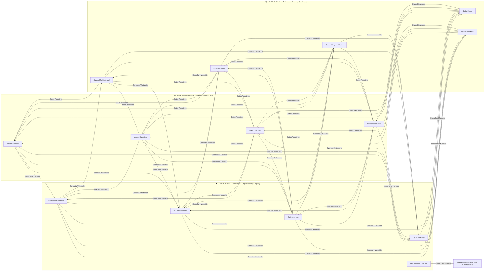
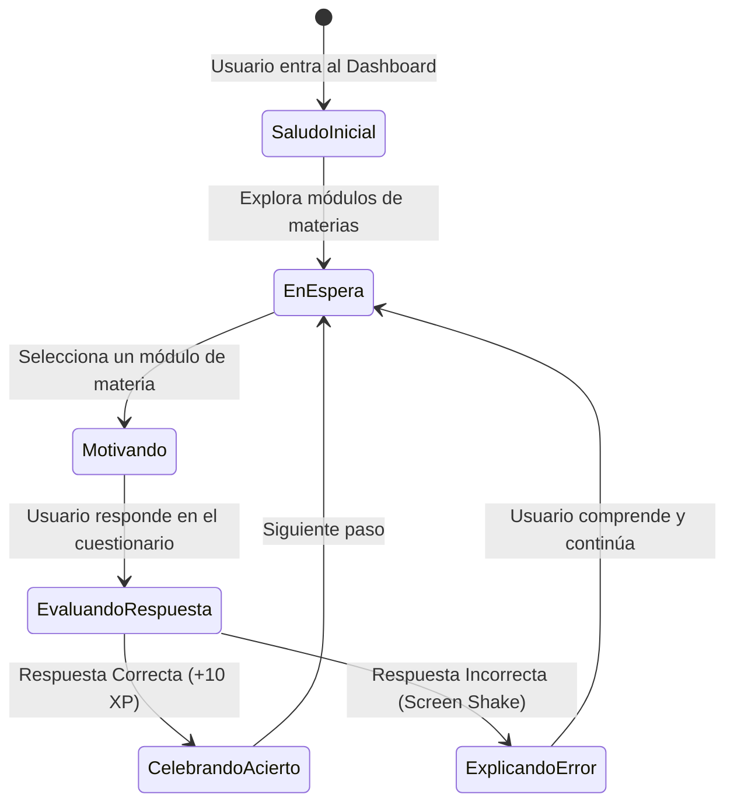

# 🎮 Plan Maestro del Proyecto: Plataforma de Gamificación Académica & Guía con "Dev'is"

---

## 1. Visión General del Proyecto

El objetivo del proyecto es desarrollar una **aplicación web interactiva de gamificación educativa** enfocada en cuestionarios de opción múltiple organizados por **módulos de cada materia**. 

El núcleo de la experiencia gira en torno a:
- **Aprendizaje estructurado por materias (Módulos):** Cada asignatura cuenta con su propio espacio modular, progreso e insignias.
- **Dashboard Central del Estudiante:** Panel interactivo donde el usuario selecciona el módulo de su materia, visualiza su nivel, puntos de experiencia (XP), rachas, tabla de clasificación y vitrina de insignias.
- **Mascota Guía Interactiva ("Dev'is"):** Un compañero virtual inspirado en la estética *low-poly mística* que saluda al estudiante, reacciona en tiempo real a su desempeño y **explica pedagógicamente por qué una respuesta es incorrecta** durante los cuestionarios.
- **Arquitectura MVC Modular:** Separación estricta entre **Modelos** (datos y reglas de negocio), **Vistas** (interfaz reactiva y animaciones) y **Controladores** (orquestación de lógica, eventos de gamificación y comunicación con servicios externos).

---

## 2. Dirección de Arte y Sistema de Diseño (Inspiración Low-Poly Místico)

Tomando como base la imagen de referencia (paisaje nocturno estrellado, espíritu guardián gigante en tonos púrpura cristalino con marcas de luz amarilla, río turquesa, vegetación geométrica verde lima y hongos rosados), el diseño visual seguirá una estética **"Low-Poly Mystical Adventure"**.

### 2.1 Paleta de Colores Oficial

| Rol en la UI | Nombre del Color | HEX | Uso Principal |
| :--- | :--- | :--- | :--- |
| **Fondo Principal** | Azul Noche Estrellada | `#141E30` | Fondo general de la aplicación y cielo nocturno |
| **Fondo Secundario** | Índigo Montaña | `#242F59` | Tarjetas de módulos, paneles laterales (Sidebar) y modales |
| **Color Primario (Marca / Dev'is)** | Púrpura Guardián | `#4A2574` | Encabezados, contenedor de **Dev'is**, botones principales |
| **Primario Vibrante** | Violeta Cristal | `#8B5CF6` | Estados activos, bordes iluminados, selección de opciones |
| **Acento Rúnico (XP / Nivel)** | Amarillo Luz Rúnica | `#FACC15` | Puntos flotantes (`+10 XP`), estrellas, ojos/runas de Dev'is |
| **Éxito / Progreso** | Verde Lima Poligonal | `#84CC16` | Barras de progreso completadas, respuestas correctas |
| **Fluidez / Información** | Turquesa Río | `#06B6D4` | Barras de nivel, enlaces, indicadores de tiempo/racha |
| **Insignias / Especial** | Rosa Hongo Místico | `#F472B6` | Medallas raras, cofres de recompensa, efectos especiales |
| **Error / Alerta** | Rojo Guerrero Coral | `#E11D48` | Respuestas incorrectas, temblor de pantalla, alerta de explicación |
| **Superficie Terrosa** | Tierra / Roca Cálida | `#7C4D3A` | Bordes secundarios, divisores y detalles de ambiente |

### 2.2 Características del Estilo Visual (UI Art Style)
1. **Geometría Facetada (Low-Poly UI):** Tarjetas y botones con bordes ligeramente biselados o cortes angulares sutiles (`clip-path` poligonal y gradientes diagonales que simulan facetas 3D iluminadas).
2. **Atmósfera Nocturna Luminosa:** Fondos oscuros con partículas de estrellas sutiles y acentos bioluminiscentes (sombras brillantes en amarillo rúnico `#FACC15`, violeta `#8B5CF6` y turquesa `#06B6D4`).
3. **Diseño de la Mascota "Dev'is":** Inspirado en el guardián púrpura de la referencia: una criatura geométrica/low-poly de cristal púrpura con ojos y runas amarillas brillantes y detalles naturales, con distintos estados emocionales (*Saludo*, *Pensando*, *Celebrando*, *Explicando Error*).

---

## 3. Stack Tecnológico y Rol de cada Herramienta

### 3.1 Frontend (Interfaz, Estado y Micro-interacciones)
- **Next.js + React (TypeScript):** Renderizado híbrido y arquitectura de componentes reutilizables (tarjetas de módulos, contenedor de cuestionarios, barras de progreso, HUD de jugador y widget de **Dev'is**).
- **Tailwind CSS:** Configuración de tokens personalizados con la paleta *Low-Poly Mystical*, utilidades para gradientes poligonales y diseño 100% responsivo.
- **Framer Motion / GSAP:**
  - *Framer Motion:* Transiciones entre vistas del Dashboard, aparición fluida de los diálogos de **Dev'is**, barras de progreso animadas y micro-interacciones en tarjetas.
  - *GSAP:* Secuencias de animación de alto impacto como puntos flotantes (`+10 XP`), sacudida de pantalla (*screen shake*) al fallar una pregunta y llenado energético de barras de nivel.
- **LottieFiles (`lottie-react`):** Reproducción ligera en JSON de efectos complejos: explosiones de confeti al terminar un módulo, desbloqueo de insignias, cofres abriéndose y animaciones por estados de **Dev'is**.

### 3.2 Backend, Tiempo Real y Base de Datos
- **Supabase / Firebase (BaaS):** Autenticación de estudiantes, persistencia de perfiles, catálogo de materias/módulos, banco de preguntas con sus explicaciones asociadas para **Dev'is**, y suscripciones en tiempo real.
- **Node.js + Socket.io:** Servidor de WebSockets de baja latencia para sesiones de cuestionarios multijugador síncronos (salas en vivo donde un presentador/docente lanza preguntas con temporizador y todos compiten al mismo tiempo).
- **Redis:** Almacenamiento en memoria (usando *Sorted Sets* `ZADD` / `ZREVRANGE`) para calcular y actualizar las **Tablas de Clasificación (Leaderboards)** globales y por materia en milisegundos.

### 3.3 Motor de Gamificación (Headless API)
- **Trophy API (Principal) / Mambo.io o Captain Up (Escalabilidad):**
  - Gestión desacoplada de rachas diarias (*streaks* con soporte de zona horaria), reglas de economía de experiencia (XP), umbrales de subida de nivel y desbloqueo automático de insignias/logros.

---

## 4. Arquitectura MVC Modular por Materia

Para cumplir con el patrón **Modelo - Vista - Controlador (MVC)** dentro de una aplicación moderna en Next.js y mantener cada materia organizada de forma modular, el proyecto se estructurará combinando una capa MVC transversal con paquetes modulares por materia:



### Estructura de Directorios Propuesta

```text
src/
├── app/                            # Enrutamiento de Next.js ( Entrypoints de rutas )
│   ├── layout.tsx
│   ├── page.tsx                    # Redirige o carga el Dashboard Principal
│   ├── dashboard/
│   │   └── page.tsx                # Conecta DashboardController con DashboardView
│   └── modules/
│       └── [subjectId]/
│           └── page.tsx            # Conecta ModuleController + QuizController con su Vista
│
├── models/                         # CAPA MODELO (M): Esquemas, tipos, repositorios y datos
│   ├── entities/
│   │   ├── SubjectModule.model.ts  # Estructura de una materia y sus sub-módulos
│   │   ├── QuizAttempt.model.ts    # Estado del intento, respuestas e historial
│   │   ├── Badge.model.ts          # Definición de insignias, rareza y requisitos
│   │   ├── UserProgress.model.ts   # Nivel, XP total, racha activa y estadísticas
│   │   └── DevisMascot.model.ts    # Estados de ánimo, diálogos y explicaciones de Dev'is
│   ├── subjects/                   # División modular por cada materia de clase
│   │   ├── verificacion-validacion-software/
│   │   │   └── module.model.ts
│   │   └── gestion-procesos-calidad/
│   │       └── module.model.ts
│   └── repositories/               # Adaptadores hacia Mock Data (Prototipo) o Supabase/Redis/Trophy
│
├── controllers/                    # CAPA CONTROLADOR (C): Lógica de aplicación y manejadores
│   ├── useDashboardController.ts   # Filtra módulos, calcula resumen de progreso e insignias
│   ├── useModuleController.ts      # Gestiona la entrada a una materia y su estado de bloqueo/avance
│   ├── useQuizController.ts        # Evalúa opciones, dispara +XP o temblor y notifica a Dev'is
│   ├── useDevisController.ts       # Controla qué dice Dev'is (saludo, pista, explicación de error)
│   └── useGamificationController.ts# Conecta con Trophy API / Redis Leaderboard
│
├── views/                          # CAPA VISTA (V): Componentes visuales puros y animaciones
│   ├── layouts/
│   │   └── MysticalShellView.tsx   # Fondo estrellado low-poly, HUD superior y barra lateral
│   ├── dashboard/
│   │   ├── DashboardView.tsx       # Vista maestra del Dashboard
│   │   ├── SubjectGridView.tsx     # Cuadrícula de módulos por materia
│   │   ├── ProgressOverviewView.tsx# Barras de XP, nivel y racha
│   │   └── BadgesShowcaseView.tsx  # Vitrina de insignias con animaciones Lottie
│   ├── quiz/
│   │   └── QuizPrototypeView.tsx   # Simulador de pregunta para probar animaciones y a Dev'is
│   └── mascot/
│       └── DevisWidgetView.tsx     # Avatar low-poly de Dev'is + burbuja de diálogo interactiva
│
└── shared/                         # Utilidades, configuración de tema Tailwind, assets Lottie
```

---

## 5. La Mascota "Dev'is": Diseño Funcional y Pedagógico

**Dev'is** no es solo un elemento decorativo; es el **tutor gamificado** del sistema. Su comportamiento está gobernado por `useDevisController` y `DevisMascot.model`:



1. **Modo Saludo y Guía Contextual (Dashboard):**
   - Al abrir la plataforma, **Dev'is** recibe al estudiante por su nombre, le recuerda su racha actual y le sugiere qué módulo de materia continuar.
2. **Modo Reacción Positiva (Acierto):**
   - Sus runas amarillas brillan intensamente, lanza una frase breve de celebración mientras aparece la animación flotante de `+10 XP`.
3. **Modo Explicación de Respuesta Incorrecta (Core Pedagógico):**
   - Cuando el usuario selecciona una opción incorrecta:
     1. La tarjeta tiembla suavemente (Framer Motion / GSAP) y se marca en tono *Rojo Guerrero Coral* (`#E11D48`).
     2. **Dev'is** cambia a su estado de *Explicación Sabia* (ojos rúnicos encendidos y gesto empático).
     3. Se despliega el panel de diálogo de **Dev'is** explicando **por qué la opción elegida no es correcta** y cuál es el razonamiento detrás de la respuesta correcta antes de continuar.

---

## 6. Fases de Construcción del Proyecto Completo (Roadmap General)

| Fase | Nombre | Alcance Principal |
| :--- | :--- | :--- |
| **Fase 1** | **Prototipo Interactivo (Actual)** | Estructura MVC base en Next.js + Tailwind, tema visual Low-Poly Místico, Dashboard con selector de módulos por materia, barras de progreso, vitrina de insignias, presencia interactiva de **Dev'is** y simulador de estados (sin banco real de preguntas aún). |
| **Fase 2** | **Motor de Cuestionarios y Contenido** | Carga dinámica de cuestionarios de opción múltiple por materia, temporizadores, retroalimentación pedagógica real en **Dev'is** y animaciones completas con Framer Motion, GSAP y Lottie. |
| **Fase 3** | **Persistencia y Gamificación Headless** | Integración con **Supabase/Firebase** para usuarios y progreso por materia, e integración con **Trophy API** para rachas, niveles y desbloqueo de insignias reales. |
| **Fase 4** | **Multijugador en Tiempo Real y Leaderboards** | Servidor **Node.js + Socket.io** para partidas síncronas en clase y **Redis** para tablas de clasificación instantáneas por materia y globales. |

---

## 7. Cómo se Construirá el Primer Prototipo (Plan de Implementación Paso a Paso)

Dado que **en esta primera etapa solo construiremos el prototipo funcional de la interfaz y la arquitectura** (sin cargar aún los cuestionarios definitivos ni conectar servicios de backend en producción), el prototipo se enfocará en validar el **flujo de usuario, la arquitectura MVC, el estilo visual de la imagen de referencia y la interacción con Dev'is**.

### 7.1 Alcance Exacto del Primer Prototipo
1. **Esqueleto MVC Funcional:** Carpetas `models/`, `views/` y `controllers/` implementadas con datos simulados (*mock models*) listos para ser reemplazados después por Supabase y Trophy.
2. **Ambientación Visual Low-Poly Mística:** Fondo nocturno estrellado inspirado en la imagen de referencia, tarjetas con estética poligonal, paleta púrpura/índigo/amarillo rúnico/verde lima/turquesa.
3. **Dashboard Principal Completo:**
   - **HUD Superior del Estudiante:** Nivel actual, barra de experiencia (XP) animada, contador de racha diaria y monedas/cristales.
   - **Selector de Módulos por Materia:** Tarjetas interactivas para las materias (ej. *Estructura de Datos*, *Ingeniería de Software*, *Bases de Datos*, *Arquitectura Web*), mostrando porcentaje de progreso, nivel del módulo y estado.
   - **Panel de Progreso e Insignias:** Sección visual donde se muestran las insignias obtenidas y bloqueadas (con espacio para animaciones Lottie) y estadísticas generales.
4. **Mascota Interactiva "Dev'is" en Acción:**
   - Componente visual de **Dev'is** siempre accesible en el Dashboard (con saludo dinámico al entrar y al pasar o seleccionar cada módulo de materia).
   - **Modo Demo / Laboratorio de Retroalimentación de Dev'is:** Un pequeño panel o vista de prueba dentro de un módulo (con una "Pregunta Prototipo / Placeholder") donde podrás hacer clic en *"Simular Respuesta Correcta"* (`+10 XP` flotante) o *"Simular Respuesta Incorrecta"* (sacudida de pantalla + **Dev'is** desplegando la explicación detallada del error) para comprobar todo el flujo visual antes de redactar las preguntas reales.

### 7.2 Paso a Paso Técnico para Construir el Prototipo

#### Paso 1: Inicialización del Proyecto y Dependencias de UI/Animación
- Inicializar proyecto con **Next.js (App Router + TypeScript)** y **Tailwind CSS**.
- Instalar librerías de animación e iconografía del prototipo:
  - `framer-motion` (transiciones de tarjetas, barras de progreso, modales de Dev'is).
  - `gsap` (efectos de puntos flotantes `+10 XP` y *screen shake* en errores).
  - `lottie-react` (animaciones JSON para trofeos, confeti y destellos mágicos).
  - `lucide-react` (iconografía complementaria para módulos e insignias).

#### Paso 2: Configuración del Sistema de Diseño (Tema Low-Poly Mystical)
- Configurar en Tailwind las variables de color extraídas de la imagen (`mystic-night`, `guardian-purple`, `rune-yellow`, `poly-lime`, `river-cyan`, `shroom-pink`, `warrior-red`).
- Crear utilidades CSS para fondos con cielo estrellado, bordes facetados tipo cristal low-poly y efectos de resplandor (`glow`).

#### Paso 3: Construcción de la Capa Modelo (`src/models/`)
- Crear `SubjectModule.model.ts`: define los módulos de tus materias (ID, nombre, icono, color temático, % de avance, total de cuestionarios, estado).
- Crear `Badge.model.ts` y `UserProgress.model.ts`: datos iniciales del estudiante (Nivel, XP, racha de días, lista de insignias desbloqueadas y por desbloquear).
- Crear `DevisMascot.model.ts`: catálogo de mensajes de saludo de **Dev'is**, reacciones por materia y plantilla de explicación cuando ocurre una respuesta incorrecta.

#### Paso 4: Construcción de la Capa Controlador (`src/controllers/`)
- `useDashboardController.ts`: entrega a la vista la lista de módulos, filtra por estado (En curso / Completados), selecciona un módulo activo y coordina los cambios en el Dashboard.
- `useDevisController.ts`: gestiona el estado actual de **Dev'is** (`greeting`, `idle`, `celebrating`, `explaining_error`), cambia su diálogo dinámicamente según lo que haga el usuario y expone las acciones de simulación de acierto/error.

#### Paso 5: Construcción de la Capa Vista (`src/views/`)
- **`MysticalShellView`:** Contenedor principal con estética nocturna low-poly y navegación lateral/superior.
- **`DevisWidgetView`:** Ilustración SVG/Low-Poly personalizada de **Dev'is** (inspirada en el guardián púrpura de ojos amarillos de la imagen) con animaciones de respiración, parpadeo rúnico y globo de diálogo interactivo.
- **`SubjectGridView`:** Tarjetas de cada materia con barras de progreso animadas y botón para entrar al prototipo del módulo.
- **`BadgesShowcaseView`:** Vitrina de insignias con efectos visuales al pasar el cursor.
- **`PrototypeInteractionSandboxView`:** Vista del módulo seleccionado donde aún no hay preguntas definitivas, pero permite probar la tarjeta de cuestionario prototipo (acierto con `+10 XP` y fallo con sacudida + explicación de **Dev'is**).

#### Paso 6: Verificación y Pruebas Visuales
- Ejecutar el servidor de desarrollo, verificar la fluidez de las animaciones a 60 FPS, comprobar la responsividad en escritorio y móvil, y validar que la estructura MVC permita agregar las preguntas reales de cada materia sin tocar la interfaz.

